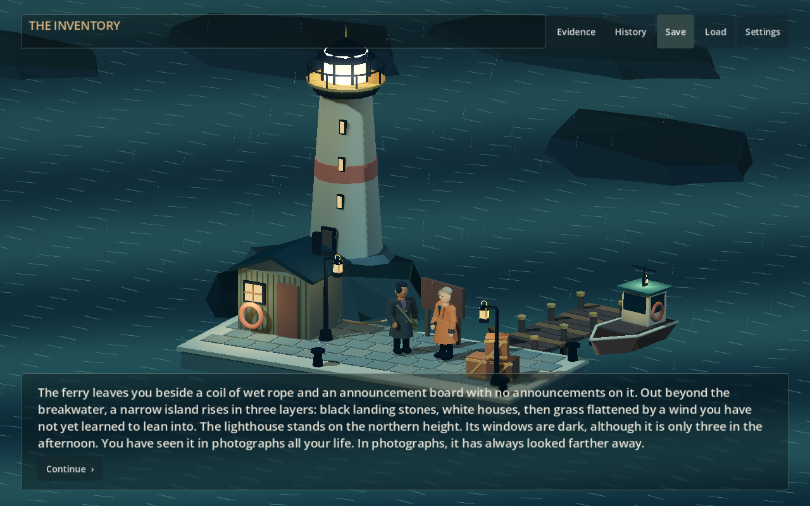

# Lanternwake

A stormbound-island mystery about reading the record, questioning what is missing and deciding what the evidence supports.

Follow an authored five-chapter story through stylized 3D locations, with rain, lighthouse light and an original MIDI score. Review testimony, collect evidence and return to unanswered questions. Optional character conversations let you linger without changing the story's canonical progress.



*Actual authored-story capture from `76b8428`, at 1280 × 800 in Godot .NET 4.6.3. Software OpenGL omits volumetric fog and depth-of-field; AI was off.*

## Play from source

Install Python 3, the complete official **Godot 4.6.3 .NET** distribution and the **.NET 8 SDK**. The ordinary non-.NET Godot build cannot compile the game.

From the repository directory, on Linux or macOS:

```sh
python3 scripts/run.py --godot "/path/to/Godot.NET/executable"
```

On Windows, use PowerShell or Command Prompt:

```powershell
py -3 scripts/run.py --godot "C:\Tools\Godot\Godot_v4.6.3-stable_mono_win64_console.exe"
```

Use your executable's actual path. You can omit `--godot` when `GODOT_MONO` names it or a suitable executable is on PATH.

The launcher prepares audio, restores packages from your installed Godot distribution, builds and launches. It downloads no tools, packages or models. **The authored story needs no model or inference account.**

See [launcher options and platform notes](docs/running.md) for editor mode, setup help and testing limits.

## Controls

- Click, Space or Enter: reveal/advance
- H: History; E: evidence catalogue; Escape: close a panel
- **Stay and talk**: open a conversation; suggestions fill editable input
- **Say this**: submit; **Return** or Escape: rejoin the story

Manual saves and automatic checkpoints let you resume. Settings offer larger reading text, instant text, reduced motion and separate sound levels. A content note is available before starting and during play.

## Optional AI

With AI off, conversations use clearly identified authored replies. Generated dialogue supports local Pumas-managed llama.cpp or OpenRouter; [setup and privacy details](docs/PUMAS.md) explain both. OpenRouter sends dialogue and bounded story context to its service and upstream provider, using your account's credits. Avoid private real-world information in fictional dialogue.

[Microphone transcription](docs/SPEECH.md) is an explicit, off-by-default local experiment; real microphone and model testing remain open.

## Development

Lanternwake is in development. Five hours is a playtest target.

- [Edit scenes, characters and story text](docs/AUTHORING.md)
- [Player-flow testing](docs/APPLICATION-ACCEPTANCE-20261011.md) and [verification records](docs/VERIFICATION.md)
- [Architecture](docs/ARCHITECTURE.md), [audio](docs/AUDIO.md) and [export requirements](docs/EXPORT-SOLUTION.md)

Story, artwork and MIDI compositions are original project work. MeltySynth and the instrument bank have [separate licences](docs/AUDIO.md#provenance-and-verification).
